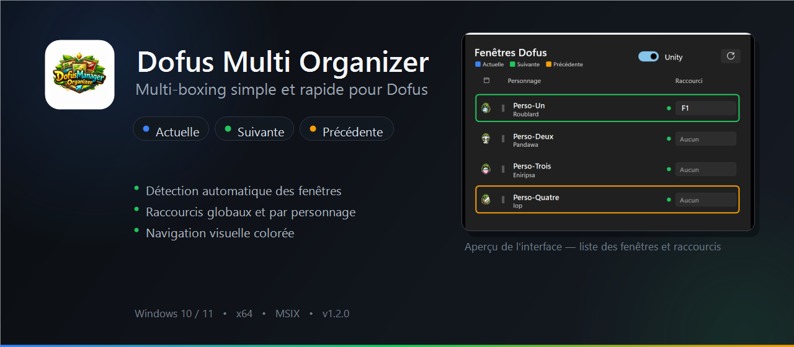
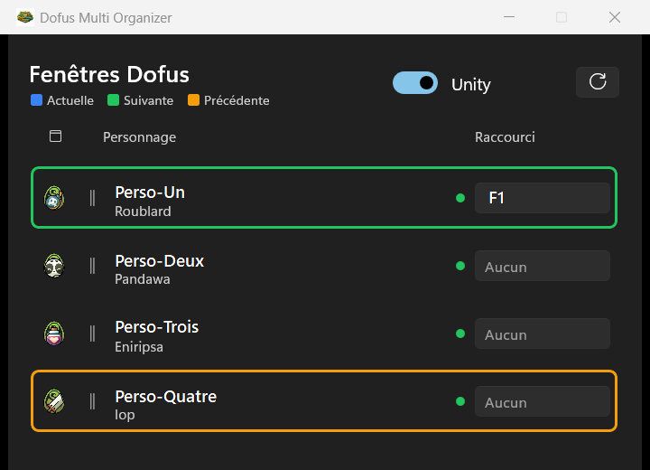
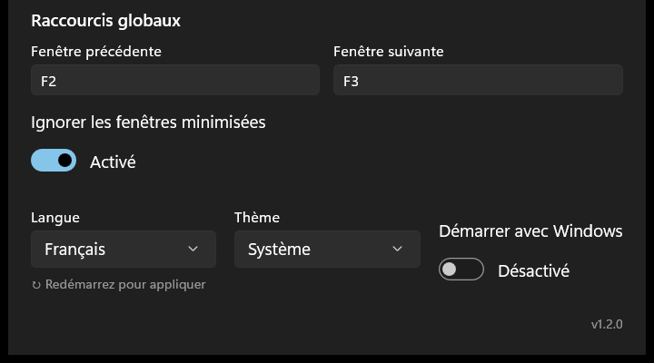

<p align="center">
  
</p>

<p align="center">
  <a href="https://github.com/Madgique/dofus-multi-organizer/releases/latest"></a>
  
  
  
</p>

# Dofus Multi Organizer

Outil de multi-boxing pour Dofus : détection automatique des fenêtres, raccourcis globaux et navigation visuelle entre les personnages.

## Téléchargement

**[Télécharger la dernière version](https://github.com/Madgique/dofus-multi-organizer/releases/latest)** — Windows 10 2004+ / Windows 11, x64.

1. Télécharger le `.msix` et le `.cer` depuis la dernière release.
2. **Première installation uniquement** : double-cliquer sur le `.cer` → **Installer un certificat** → choisir **Ordinateur local** (admin) ou **Utilisateur actuel** → **Placer tous les certificats dans le magasin suivant** → **Parcourir** → **Autorités de certification racines de confiance** → Terminer.
3. Double-cliquer sur le `.msix` → **Installer**.

> Si le certificat a déjà été installé pour une version précédente, il suffit d'installer le `.msix`.

## Aperçu

<p align="center">
  
</p>

<p align="center"><sub>Aperçu avec des personnages de démonstration.</sub></p>

<details>
<summary>Voir les réglages</summary>
<p align="center">
  
</p>
</details>

## Fonctionnalités

- **Détection automatique** des fenêtres Dofus ouvertes
  - Mode **Unity** : classe Win32 `UnityWndClass` + processus `dofus*` (filtre les autres jeux Unity)
  - Mode **Rétro** : processus `dofus*` (client Chromium x64 ou Shockwave x86 — filtre Chrome/Edge/Discord)
- **Raccourcis globaux** fenêtre suivante / précédente (cyclique)
- **Navigation visuelle** dans la liste :
  - 🔵 bleu = fenêtre actuelle
  - 🟢 vert = cible du raccourci « suivante »
  - 🟠 orange = cible du raccourci « précédente »
- **Raccourci direct** par personnage (configurable individuellement)
- **Réordonnancement** par drag & drop
- **Capture de touche** : cliquer sur le champ de raccourci puis appuyer sur la touche souhaitée
- **System tray** : l'app tourne en arrière-plan, accessible via l'icône dans la barre des tâches
- **Démarrage avec Windows** configurable

## Mode Rétro — Mise au premier plan automatique

En mode Rétro, une option **« Mise au premier plan automatique »** permet de focus automatiquement la fenêtre du personnage dont c'est le tour de jeu (ou qui reçoit un échange, une invitation de groupe…).

L'app intercepte les notifications Windows envoyées par Dofus Rétro — format `"[Personnage] - Dofus Retro v..."` — et met la fenêtre correspondante au premier plan.

> **Note :** L'option utilise `UserNotificationListener` (Windows 10+). Désactiver le son ou la bannière dans les paramètres Windows est OK. Désactiver entièrement les notifications Dofus empêcherait le listener de fonctionner.

## Limitations connues

- Les fenêtres Dofus **minimisées** peuvent être ignorées lors du focus (option « Ignorer les fenêtres minimisées » configurable).
- L'auto-focus Rétro ne fonctionne pas si les notifications Windows de Dofus sont **entièrement** désactivées.

## Utilisation

1. Lancer Dofus et ouvrir les comptes souhaités.
2. Sélectionner le mode (**Rétro** ou **Unity**) via le toggle en haut de la fenêtre.
3. Cliquer sur **Refresh** pour détecter les fenêtres.
4. Configurer les raccourcis via les champs de capture (clic → touche).
5. Fermer la fenêtre settings → l'app continue en tray.

## Build

```
cd DofusMultiOrganizer
dotnet build DofusMultiOrganizer.slnx -c Debug -p:Platform=x64
```

Ou via **F5** dans Visual Studio 2022 (déploiement MSIX).

## Stack

- C# / WinUI 3 / Windows App SDK 1.8
- .NET 8 / MSIX packaged / x64
- MVVM (CommunityToolkit.Mvvm) + DI (Microsoft.Extensions)
